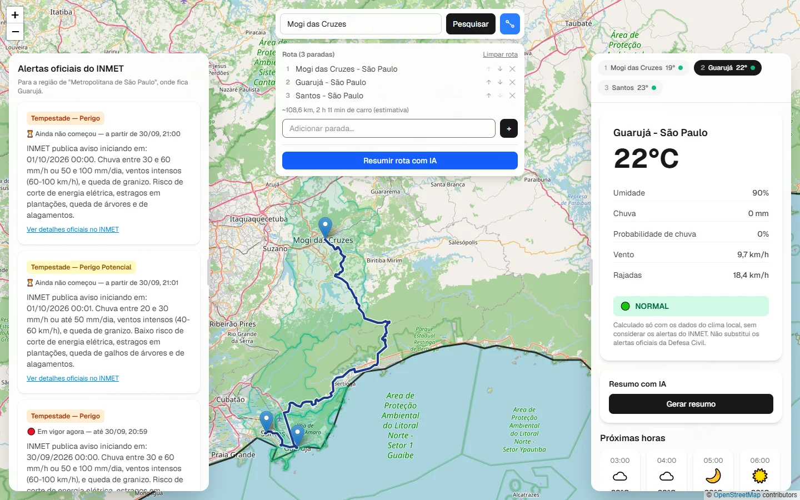
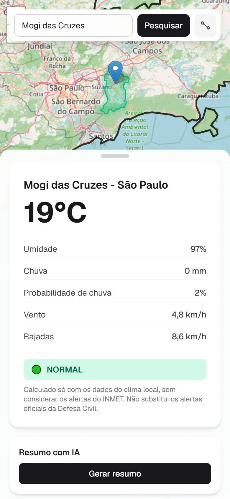

<div align="center">

# PreVAlerta

**Clima, alertas oficiais e risco meteorológico das cidades do Estado de São Paulo, num mapa interativo - para uma cidade ou para uma rota inteira.**

[](https://nextjs.org/)
[](https://react.dev/)
[](https://www.typescriptlang.org/)
[](https://tailwindcss.com/)
[](https://leafletjs.com/)
[](./LICENSE)

**[Acessar o PreVAlerta →](https://prev-alerta.vercel.app)**

</div>



## Sobre

O PreVAlerta nasceu de um problema real: ao planejar uma viagem de Mogi das Cruzes para o Guarujá, não havia um lugar simples para comparar a situação das duas cidades - uma tinha um alerta leve da Defesa Civil, a outra um bem mais grave. O objetivo do projeto é responder de forma direta: **como está a situação dessa região agora, e nas próximas horas?**

Para isso, o app reúne numa só tela o clima atual, a previsão das próximas 24 horas, os alertas oficiais do INMET e uma classificação de risco calculada a partir dos dados meteorológicos - para uma cidade ou para todas as paradas de uma viagem.

## Funcionalidades

### Consulta por cidade

- Busca de qualquer município do Estado de São Paulo, com histórico das pesquisas recentes salvo no navegador.
- Condições atuais (temperatura, umidade, chuva, probabilidade de chuva, vento e rajadas) e previsão hora a hora para as próximas 24 horas.
- Alertas oficiais do INMET filtrados pela mesorregião do município. Se o INMET estiver fora do ar, o app avisa em vez de mostrar uma lista vazia.
- Classificação de risco própria, em quatro níveis (veja [como ela é calculada](#classificação-de-risco)).
- Contorno oficial do município no mapa, pintado na cor do risco e enquadrado automaticamente na área livre entre os painéis.

### Planejamento de rota

- Rota com até 25 paradas, traçada pelas estradas, com distância e tempo estimados de carro.
- Paradas reordenáveis e removíveis. O painel de edição pode ser escondido sem desfazer a rota.
- Uma aba por cidade para alternar entre o clima, os alertas e o risco de cada parada, com a temperatura e a cor de risco visíveis em todas as abas. Clicar numa cidade no mapa também abre a aba dela.

### Resumo com IA

- Resumo curto em linguagem natural, gerado sob demanda pelo Google Gemini, para uma cidade ou para a rota inteira (até 10 paradas).
- A IA recebe apenas os dados exibidos na tela e segue regras explícitas: não inventa informações, não altera a gravidade dos alertas e não afirma se um local é seguro ou perigoso. **A IA explica, não decide.**

### Interface

- Desktop: mapa em tela cheia com painéis laterais de largura ajustável (a largura escolhida fica salva).
- Celular: gaveta na parte de baixo da tela, que abre e recolhe arrastando.
- Modo escuro automático, conforme a preferência do sistema.

<p align="center">
  
</p>

## Classificação de risco

A classificação usa apenas os dados meteorológicos do local, com regras simples e transparentes ([`lib/riskClassification.ts`](lib/riskClassification.ts)). Ela é independente dos alertas oficiais, que aparecem separados.

| Nível | Condição (basta uma) |
| --- | --- |
| 🔴 Crítico | chuva ≥ 30 mm ou rajadas ≥ 70 km/h |
| 🟠 Risco elevado | chuva ≥ 15 mm, rajadas ≥ 50 km/h ou probabilidade de chuva ≥ 70% |
| 🟡 Atenção | chuva ≥ 5 mm, rajadas ≥ 35 km/h ou probabilidade de chuva ≥ 50% |
| 🟢 Normal | nenhuma das condições acima |

"Chuva" é a precipitação atual informada pela Open-Meteo; a probabilidade de chuva é a da próxima hora.

## Fontes de dados

| Dado | Fonte |
| --- | --- |
| Clima atual, previsão e busca de cidades | [Open-Meteo](https://open-meteo.com/) |
| Alertas meteorológicos oficiais | [INMET](https://portal.inmet.gov.br/) (feed público de avisos) |
| Municípios, mesorregiões e contornos | [IBGE](https://servicodados.ibge.gov.br/api/docs) (APIs de localidades e de malhas) |
| Trajeto pelas estradas | [OSRM](https://project-osrm.org/) |
| Mapa | [OpenStreetMap](https://www.openstreetmap.org/) |
| Resumos em linguagem natural | [Google Gemini](https://ai.google.dev/) |

## Arquitetura

O projeto é um app [Next.js](https://nextjs.org/) (App Router) sem servidor separado: as **rotas de API** do próprio Next fazem a ponte com os serviços externos. Assim, o servidor valida as entradas, padroniza as respostas, guarda os dados em cache e mantém a chave do Gemini fora do navegador.

| Rota | O que faz | Cache |
| --- | --- | --- |
| `GET /api/weather` | Clima atual e previsão (Open-Meteo) | 10 min |
| `GET /api/alerts` | Avisos do INMET filtrados pela mesorregião do município (IBGE) | 5 min |
| `GET /api/boundary` | Contorno oficial do município (IBGE) | 1 semana |
| `GET /api/route` | Trajeto, distância e duração entre as paradas (OSRM) | 1 hora |
| `POST /api/summary` | Resumo com IA de uma cidade ou de uma rota (Gemini) | - |

A busca de cidades (geocoding da Open-Meteo) é feita direto do navegador.

**Robustez e segurança**

- Tempo limite nas chamadas aos serviços externos e mensagens de erro claras (sem internet, serviço lento, INMET indisponível).
- Mapa isolado: se ele falhar, os painéis de clima continuam funcionando.
- Validação dos parâmetros recebidos pelas rotas de API.
- Limite de pedidos por visitante no resumo com IA, para proteger a cota da chave.
- Cabeçalhos de segurança HTTP, incluindo proteção contra clickjacking.

## Tecnologias

- [Next.js 16](https://nextjs.org/) (App Router) e [React 19](https://react.dev/)
- [TypeScript](https://www.typescriptlang.org/)
- [Tailwind CSS 4](https://tailwindcss.com/)
- [Leaflet](https://leafletjs.com/) e [React Leaflet](https://react-leaflet.js.org/)
- [Google Gen AI SDK](https://github.com/googleapis/js-genai) (`@google/genai`), para o Gemini
- Deploy na [Vercel](https://vercel.com/)

## Como rodar localmente

Pré-requisito: [Node.js](https://nodejs.org/) 20.9 ou superior.

```bash
git clone https://github.com/VictorSiquetto/PreVAlerta.git
cd PreVAlerta
npm install
npm run dev
```

Depois, abra [http://localhost:3000](http://localhost:3000).

### Resumo com IA (opcional)

As fontes de dados são públicas e não exigem chave, então o app funciona sem nenhuma configuração - com exceção do resumo com IA, que usa a API do Google Gemini (há camada gratuita). Para ativá-lo, gere uma chave no [Google AI Studio](https://aistudio.google.com/apikey) e crie um arquivo `.env.local` na raiz do projeto (ele já é ignorado pelo Git):

```env
GEMINI_API_KEY=sua-chave-aqui
```

Sem a chave, o botão de resumo informa que o recurso não está disponível.

### Scripts

| Comando | Descrição |
| --- | --- |
| `npm run dev` | Servidor de desenvolvimento |
| `npm run build` | Build de produção |
| `npm run start` | Servidor de produção (depois do build) |
| `npm run lint` | Verificação com ESLint |

## Estrutura do projeto

```
app/
  api/          rotas de API (clima, alertas, contorno, rota e resumo)
  page.tsx      página principal
components/     componentes da interface (mapa, painéis, abas, gaveta...)
lib/            regras, hooks e utilitários (risco, prompts da IA, enquadramento do mapa...)
services/       chamadas às rotas de API e aos serviços externos
types/          tipos TypeScript compartilhados
data/           contorno do Estado de São Paulo (GeoJSON)
docs/           capturas de tela usadas neste README e dossiê do projeto
```

## Documentação acadêmica

O planejamento do projeto (Product Discovery, prototipação em IHC, Engenharia de Requisitos e Product Backlog) está no [Dossiê de Projeto M1](docs/dossie/Dossie_PreVAlerta.pdf), desenvolvido para a disciplina de Métodos Ágeis e Interação Humano-Computador da Universidade de Mogi das Cruzes. O andamento das Sprints pode ser acompanhado no [quadro do GitHub Projects](https://github.com/users/VictorSiquetto/projects/1).

## Aviso

O PreVAlerta é um projeto independente, de caráter informativo, e **não substitui os alertas oficiais** do INMET e da Defesa Civil. Em situações de risco, siga sempre as orientações das autoridades.

## Licença

Distribuído sob a licença [MIT](./LICENSE).

---

Desenvolvido por [Victor Siquetto](https://github.com/VictorSiquetto), Nicolas Oliveira, Arthur Silva e Rafael Bueno.
